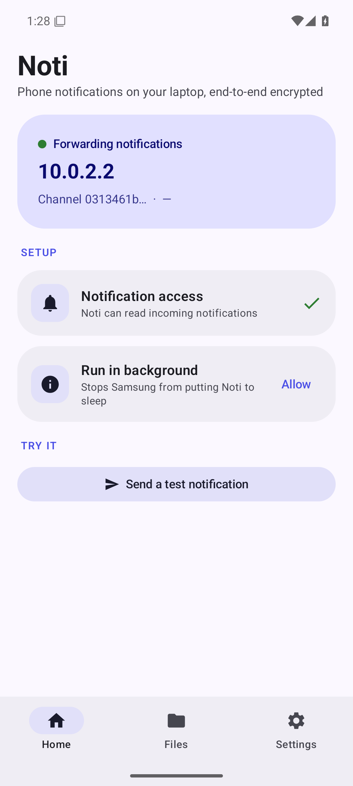
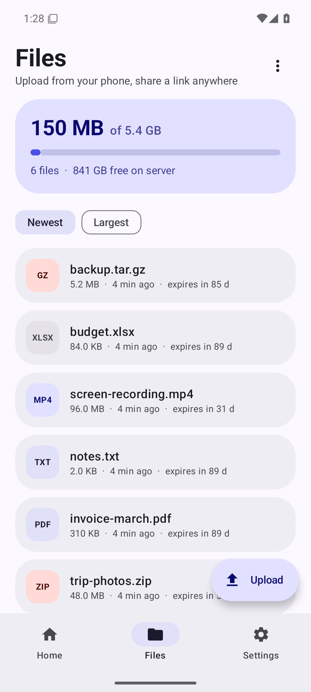
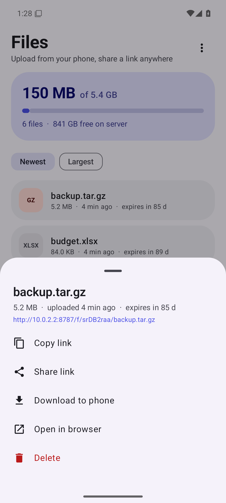
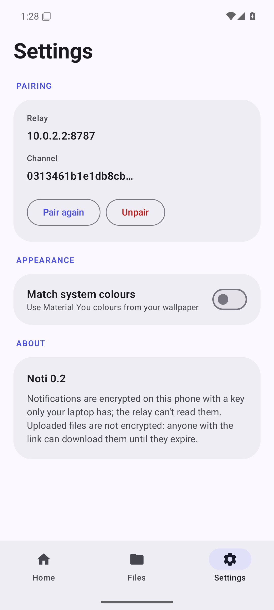

# vps-tools

Small, security-minded tools that run on my VPS (or talk to it):

1. **noti** — end-to-end encrypted notification relay: Android phone → VPS relay → Linux laptop.
2. **upload** — 0x0.st-style file upload authenticated by my ssh key.

## upload

`upload <file>` streams the file over ssh to a restricted `upload` user (forced command
`noti-upload-recv`), which stores it in `/var/lib/noti-upload/files/<id>/<name>`. The site serves it
read-only at `https://anurag3301.dev/f/<id>/<name>` (Flask route, nosniff + sandbox CSP, risky types
forced to download). It prints the link and a QR, copies it, and logs to `~/.upload_list`.

| Command | What |
|---|---|
| `upload <file>` | upload (max 256 MB; retention 90 days for tiny files down to 10 days at the limit) |
| `upload stat` | server total / free / used storage |
| `upload list` | fzf, newest first; Enter downloads |
| `upload rm` | fzf, largest first; Enter deletes after y/n |
| `upload clear` | delete everything after y/n |

Everything except downloading needs the ssh key. Server setup: `deploy/setup-upload.sh`
(copy `noti-upload-recv` and the `noti-upload-gc.*` units to `/tmp` on the VPS first).

## noti

End-to-end encrypted notification relay: Android phone → VPS relay → Linux laptop.

```
phone app ──HTTPS POST (ciphertext)──► relay (VPS, Caddy TLS) ◄──HTTPS long-poll── laptop daemon ──► notify-send
```

| Path | What |
|---|---|
| `crates/proto` | Shared crypto/protocol (HKDF, ChaCha20-Poly1305, HMAC request signing) |
| `crates/relay` | `noti-relay`: closed, in-memory relay (axum) |
| `crates/daemon` | `noti-daemon`: pair / share / join / run / install / `test-send` (Linux + Windows) |
| `crates/upload` | `upload` client |
| `crates/store` | Shared upload store (quota, retention, gc) used by the relay and the ssh receiver |
| `crates/upload-recv` | `noti-upload-recv`: server-side receiver, list/delete, gc |
| `android/` | Kotlin + Jetpack Compose (Material 3) app: notification forwarder and file manager |
| `deploy/` | systemd units, Caddyfile, VPS hardening script |

## Phone app

The paired phone is also a client of the upload store, authenticated with the same phone key (no extra secrets).
Upload from the Files tab or via the Android share sheet, then list, copy/share the link, download or delete.
It uses the relay's phone-role endpoints (`GET /v1/files`, `GET /v1/files/stat`, `PUT /v1/files/:name`,
`DELETE /v1/files/:id`, `POST /v1/files/clear`). A PUT signs the body's SHA-256 up front, and the relay streams the
body to disk and verifies the hash, so large files are never buffered. Files are public links, not E2E encrypted.

| Home | Files | Actions | Settings |
|---|---|---|---|
|  |  |  |  |

Dark mode: [files](docs/screenshots/06-files-dark.png), [home](docs/screenshots/07-home-dark.png).
Screenshots come from the `demo` build variant (`./gradlew assembleDemo`), which allows cleartext to the
emulator host only and is never shipped.

## Security model
- **E2E:** one 32-byte secret is created on the laptop and handed to the phone via QR. Payloads are ChaCha20-Poly1305 sealed (channel id as AAD). The relay never has the key, so it only sees ciphertext.
- **Closed relay:** only channels listed in `/var/lib/noti-relay/channels.txt` exist. No open registration.
- **Auth:** every request carries `x-chan/x-ts/x-nonce/x-sig` (HMAC-SHA256 over method, path+query, ts, nonce, body hash). Separate keys per role (phone can send, laptop can poll). ±60 s window plus nonce replay cache.
- **Abuse limits:** 16 KB body, 120 sends/min/channel, 5-message ring-buffer queue (oldest dropped), 24 h TTL, 10 auth failures → 10 min IP lockout, max 2 pollers per channel.
- **No persistence** of messages; relay runs as an unprivileged `noti` user in a sandboxed systemd unit, loopback-only behind Caddy (port 8443; the main site is untouched).
- The pairing secret on the phone is wrapped by an Android Keystore key; on the laptop it's `~/.config/noti/config.json` (0600).

## Setup
```sh
cargo build --release
# laptop: pair (also registers the channel on the VPS over ssh) and run
noti-daemon pair --relay https://notify.anurag3301.dev:8443 --ssh anurag3301.dev
systemctl --user enable --now noti-daemon
noti-daemon test-send "Hello" "from the CLI"      # acts as the phone
```
Phone: install `noti-debug.apk` (`adb install`), scan the QR, grant *notification access*, set battery to *Unrestricted* (Samsung: Settings → Apps → Noti → Battery).

Android build: `cd android && ANDROID_HOME=~/Android ./gradlew assembleDebug`. Crypto interop with Rust is covered by `./gradlew testDebugUnitTest`.

## Building the client tools only
Only `noti-daemon` and `upload` (the PC-side tools) need to be built on a PC; no server crates, no Android:
```sh
cargo build --release -p daemon -p upload      # Linux / macOS-ish
cargo build --release -p daemon                # just the notification client
```
```powershell
# Windows (install Rust via rustup, MSVC build tools)
cargo build --release -p daemon -p upload
# or cross-compile from Linux: apt install gcc-mingw-w64-x86-64 && rustup target add x86_64-pc-windows-gnu
#   cargo build --release -p daemon -p upload --target x86_64-pc-windows-gnu
```
Server crates (`relay`, `upload-recv`, `store`) are Linux-only.

### Windows notes
- `noti-daemon` shows toasts via PowerShell (`long` duration, ~25 s; Windows only offers ~5 s or ~25 s). Config in `%APPDATA%\noti`, state in `%LOCALAPPDATA%\noti`.
- `noti-daemon install` adds a per-user autostart (HKCU Run key); on Linux it installs and starts the systemd user unit.
- `upload` needs OpenSSH client (`ssh`), `curl` (bundled with Windows 10+) and `fzf` for list/rm; the link is copied with `clip`. `~/.upload_list` is `%USERPROFILE%\.upload_list`.
- The Windows build is cross-compiled and type-checked but has not been run on a real Windows machine.

### First run of `upload` on a new PC
The upload account is a restricted, shell-less user (each key can only run the receiver), so nothing is hardcoded; configure once:
```sh
upload setup upload@example.com            # saved in ~/.config/upload/config (%APPDATA%\\upload\\config on Windows)
upload register you@example.com            # authorizes this PC's ~/.ssh/id_*.pub, via your normal ssh login (needs sudo on the VPS)
```
`UPLOAD_HOST` / `UPLOAD_BASE_URL` override the saved values.

## Several PCs
Each PC has its **own queue** on the relay (a 5-message ring buffer each, up to 8 PCs per channel), so one PC being off never affects another.
```sh
noti-daemon share                 # on a paired PC: prints a QR/link (contains the secret)
noti-daemon join '<link>'         # on the new PC
noti-daemon install               # start at login
```
PCs register on their first authenticated poll (`/v1/poll?dev=<id>`). Configs from before this feature use the `default` queue.

## Revoke
`ssh vps 'sudo -u noti noti-relay remove --channels /var/lib/noti-relay/channels.txt <channel-prefix>'` (picked up within 10 s), then `rm ~/.config/noti/config.json` and unpair in the app.
